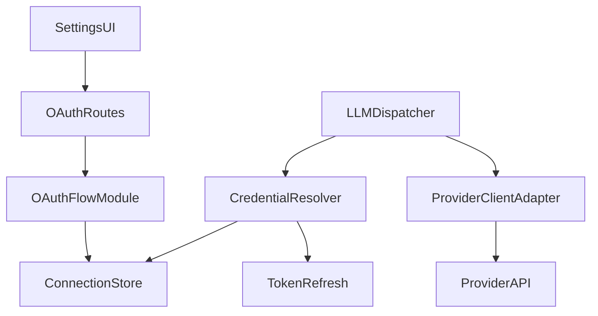

# OAuth de LLMs em Sistemas Agênticos

Skill para implementar OAuth de provedores LLM em sistemas que chamam modelos em runtime (agentes, pipelines, chat de ajuste). O foco é **conectar contas de produto** (ChatGPT/Codex, Claude Code) distintas de **API keys consumer**, persistir tokens com segurança e consumi-los de forma confiável em cada chamada ao modelo.

## Quando Usar

- Implementar ou estender tela/API de **Configurações > LLM** (ou equivalente) com OAuth
- Vincular **OpenAI Codex** (device-code), **Anthropic Claude Code** (PKCE + colar código) ou **OpenRouter** (PKCE redirect)
- Decidir se OAuth e API key do mesmo vendor devem ser **provedores separados**
- Criar **CredentialResolver** com refresh proativo antes das chamadas ao modelo
- Depurar falhas de OAuth: schema cache, redirect quebrado, import circular client/server

## Quando NÃO Usar

- Configurar apenas API key estática sem OAuth — basta secret manager + env
- OAuth de login de usuário do app (Supabase Auth, Auth0, etc.) — escopo diferente
- Escolher qual modelo usar por tarefa — isso é atribuição/runtime, não OAuth

## Modelo Mental



| Componente | Responsabilidade |
|---|---|
| **ConnectionStore** | Uma linha por provedor; discrimina `api_key` vs `oauth` |
| **OAuthRoutes** | Inicia fluxo, callback/poll/concluir; estado transitório em cookie/sessão |
| **OAuthFlowModule** | Lógica por vendor (device-code, PKCE) — server-only |
| **CredentialResolver** | Lê conexão, decifra, refresh proativo, devolve access token |
| **ProviderClientAdapter** | Endpoint e headers corretos por modo (OAuth vs API key) |
| **LLMDispatcher** | Escolhe provedor/modelo por finalidade e chama o adapter |

## Diagnóstico Antes de Codar

Responda estas perguntas antes de implementar:

| Pergunta | Decisão |
|---|---|
| OAuth usa API **diferente** da API key do mesmo vendor? | Provedor separado (ex.: OpenAI API vs Codex) |
| Qual fluxo o vendor exige? | Device-code / PKCE redirect / PKCE + colar código |
| Onde persistir tokens? | Banco ou secret store **cifrado**; nunca client/env público |
| Refresh suportado? | Resolver com skew (~120s) **antes** de expirar |
| App em subpath (`/app`)? | `APP_URL` absoluta + `BASE_PATH` nos redirects |
| Conexão por usuário ou global? | Define RLS/permissões e quem pode reconectar |

Detalhes por vendor: [fluxos-por-provedor.md](references/fluxos-por-provedor.md).

## Workflow de Implementação

Copie e marque progresso:

```text
- [ ] 1. Schema de conexões
- [ ] 2. Constantes OAuth por vendor
- [ ] 3. Helpers PKCE / state / JWT
- [ ] 4. Módulos de fluxo (um por provedor)
- [ ] 5. Rotas HTTP (iniciar → poll|callback|concluir)
- [ ] 6. Resolver + refresh server-only
- [ ] 7. Adapter de cliente LLM + UI
```

### Passo 1 — Schema

Tabela (ou equivalente) de conexões, uma linha por provedor:

| Campo | Tipo | Significado |
|---|---|---|
| `provider` | enum/text, unique | Identificador estável (`openai`, `openai-codex`, `anthropic`, `openrouter`, …) |
| `credential_type` | `api_key` \| `oauth` | Modo de autenticação |
| `encrypted_secret` | text | API key **ou** JSON OAuth cifrado |
| `connected_by` | nullable | Auditoria — quem conectou |
| `updated_at` | timestamp | Última alteração |

JSON OAuth armazenado (antes de cifrar):

```json
{
  "access_token": "...",
  "refresh_token": "...",
  "expires_at_ms": 1710000000000,
  "auth_mode": "claude_code"
}
```

Atribuições de modelo por finalidade ficam em tabela separada — OAuth só resolve **como autenticar**, não **qual modelo**.

### Passo 2 — Constantes OAuth

Centralize por vendor em um módulo `oauth/constants` (ou equivalente):

- `client_id` público do produto OAuth (Codex, Claude Code, OpenRouter)
- URLs de authorize, token, device, API de inferência
- Scopes, redirect URI registrado, skew de refresh, timeout de poll

**Não** invente client IDs — copie de documentação oficial ou de implementação open-source de referência (ex.: Hermes Agent). Trate como constantes de produto, não segredos do deploy.

### Passo 3 — Helpers compartilhados

Implemente uma vez, reutilize em todos os fluxos PKCE:

- **PKCE S256:** `verifier` (32 bytes base64url) → `challenge = SHA256(verifier)` base64url
- **State:** token aleatório anti-CSRF; validar na troca do código
- **JWT decode (opcional):** extrair `exp` do access token Codex para refresh; extrair claims de conta quando o adapter exige header extra

Módulo **sem** acoplamento a framework de UI — importável só no servidor.

### Passo 4 — Módulos de fluxo por provedor

Um arquivo por vendor em `oauth/<provider>/`:

| Vendor | Funções típicas |
|---|---|
| Codex | `startDeviceCode()`, `pollDeviceAuth()`, `exchangeCode()`, `refresh()` |
| Claude Code | `buildAuthorizeUrl()`, `exchangeCode()`, `refresh()` |
| OpenRouter | `buildAuthorizeUrl()`, `handleCallback()`, `refresh()` se aplicável |

Cada módulo retorna o contrato `StoredOAuthCredentials` normalizado.

Fluxos detalhados: [fluxos-por-provedor.md](references/fluxos-por-provedor.md).

### Passo 5 — Rotas HTTP

Padrão REST mínimo por provedor:

| Fluxo | Rotas |
|---|---|
| Device-code | `GET iniciar` → exibe `user_code`; `GET poll` → até autorizar |
| PKCE redirect | `GET iniciar` → redirect; `GET callback` → troca código |
| PKCE paste | `GET iniciar` → URL + state em sessão; `POST concluir` → código colado |

Regras:

- Estado transitório (verifier, state, device_auth_id) em **cookie httpOnly** ou sessão server-side — nunca localStorage
- Após sucesso, chame `saveOAuthConnection(provider, credentials)` e redirecione para settings com `?connected=<provider>`
- Erros: redirect com `?error=...` ou JSON 4xx/5xx — nunca vazar tokens na URL

Monte redirects com URL absoluta: `APP_URL + BASE_PATH + /settings/llm`.

### Passo 6 — Resolver + refresh (server-only)

```text
resolverCredentials(provider):
  1. Carregar linha do ConnectionStore
  2. Se credential_type == api_key → decifrar e retornar
  3. Se oauth → parsear JSON, checar expiração (skew ~120s)
  4. Se expirando → refresh(provider), upsert tokens novos, retornar access_token
  5. Lançar erro claro se provedor não conectado
```

Refresh **proativo** (antes da chamada LLM), não lazy só no HTTP 401 — evita falhas mid-stream em agentes longos.

Armazenamento e cifragem: [armazenamento-e-seguranca.md](references/armazenamento-e-seguranca.md).

### Passo 7 — Adapter de cliente LLM + UI

O adapter recebe `(provider, model, resolvedCredentials)` e monta a requisição:

| Modo | Padrão |
|---|---|
| API key | Header `Authorization: Bearer <key>` ou header vendor-specific |
| OAuth Codex | Bearer + endpoint Codex (`chatgpt.com/backend-api/codex/...`); header de conta se JWT exigir |
| OAuth Claude Code | Bearer + header beta OAuth + User-Agent de CLI + betas de produto |
| OpenRouter OAuth | Bearer + endpoint OpenRouter |

**UI de settings (genérica):**

- Card por provedor com badge: `Conectado (OAuth)` / `Conectado (API key)` / `Não conectado`
- Device-code: modal com código + instrução + polling automático
- PKCE paste: modal com link + campo de código
- PKCE redirect: botão abre nova aba; callback fecha o fluxo
- Tipos TypeScript compartilhados em módulo **sem** `"use server"` — evita import circular com server actions

## Decisão: Provedor Separado

Quando OAuth e API key do **mesmo vendor** usam **endpoints diferentes**, trate como provedores distintos no ConnectionStore e na UI:

| Exemplo | Provedor API key | Provedor OAuth |
|---|---|---|
| OpenAI | `openai` → `api.openai.com` | `openai-codex` → Codex Responses API |
| Anthropic | `anthropic` → API key consumer | `anthropic` com `credential_type=oauth` **ou** provedor distinto se contratos divergirem |

**Pró:** conexão, atribuição e adapter independentes; sem misturar credenciais.  
**Contra:** mais um card na UI; migration altera enum de provedores.

## Anti-Padrões

| Evitar | Por quê |
|---|---|
| Codex OAuth no mesmo provedor que OpenAI API key | Endpoints e tokens incompatíveis |
| Tokens OAuth em plaintext no banco ou no client | Vazamento = conta comprometida |
| Refresh só no 401 | Agentes longos falham no meio da geração |
| Omitir reload de schema cache após migration | PostgREST/Supabase retorna "column not found" |
| Importar tipos de server actions no client | Import circular, webpack/runtime quebrado |
| Hardcode redirect sem `APP_URL`/`BASE_PATH` | OAuth funciona em dev, quebra em produção |
| Expor refresh_token ao browser | Refresh deve ser server-only |

## Troubleshooting Rápido

| Sintoma | Ação |
|---|---|
| `column … not in schema cache` | Aplicar migration; `NOTIFY pgrst, 'reload schema'` |
| OAuth save 500 pós-deploy | Schema remoto desatualizado |
| Redirect OAuth inválido | Conferir `APP_URL`, `BASE_PATH`, redirect URI registrado |
| `__webpack_require__.a is not a function` | Separar tipos compartilhados de módulos `"use server"` |
| Página settings 404 intermitente (dev) | Reiniciar dev server; limpar cache de build |

Lista completa: [troubleshooting.md](references/troubleshooting.md).

## Checklist de Conclusão

Antes de considerar a tarefa concluída:

- [ ] Migration aplicada no ambiente alvo (dev **e** remoto se aplicável)
- [ ] Tokens nunca aparecem em logs, URLs ou respostas ao client
- [ ] Fluxo completo testado: conectar → atribuir modelo → gerar texto com OAuth
- [ ] Refresh testado (token perto de expirar ou forçado)
- [ ] Redirect OAuth funciona com base path de produção
- [ ] Tipos client/server separados sem import circular
- [ ] Documentação viva do projeto atualizada (se existir `directives/documentacao/`)

## Referências

- [Fluxos por provedor](references/fluxos-por-provedor.md) — Codex, Claude Code, OpenRouter
- [Armazenamento e segurança](references/armazenamento-e-seguranca.md) — cifragem, env vars, RLS
- [Troubleshooting](references/troubleshooting.md) — sintomas, causas, ações
